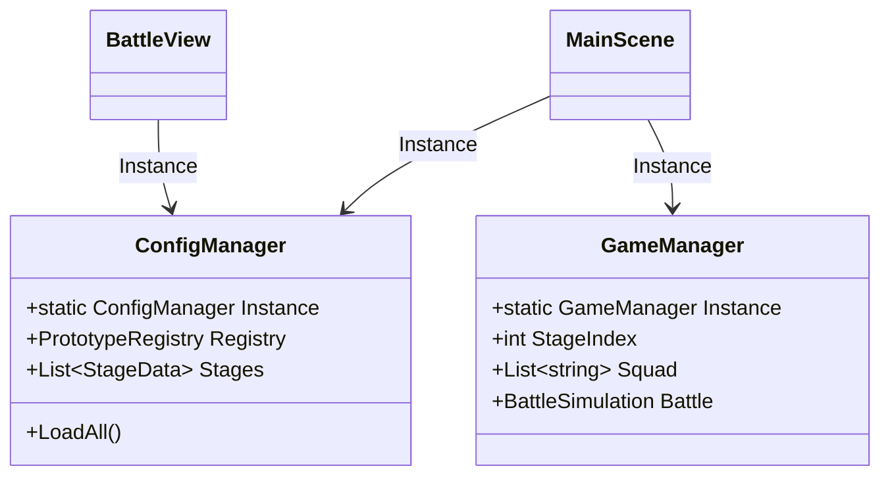
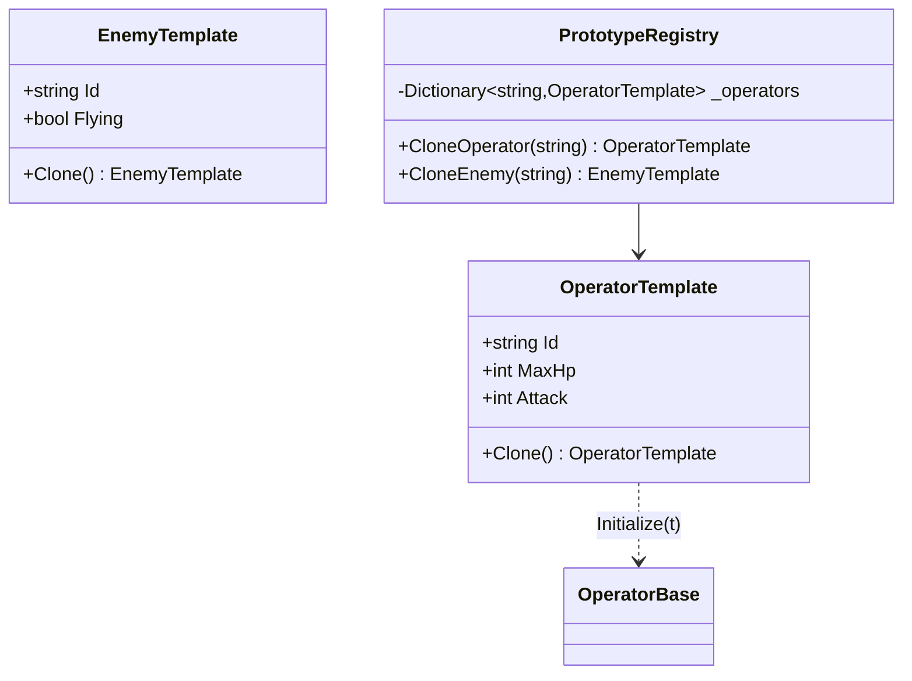
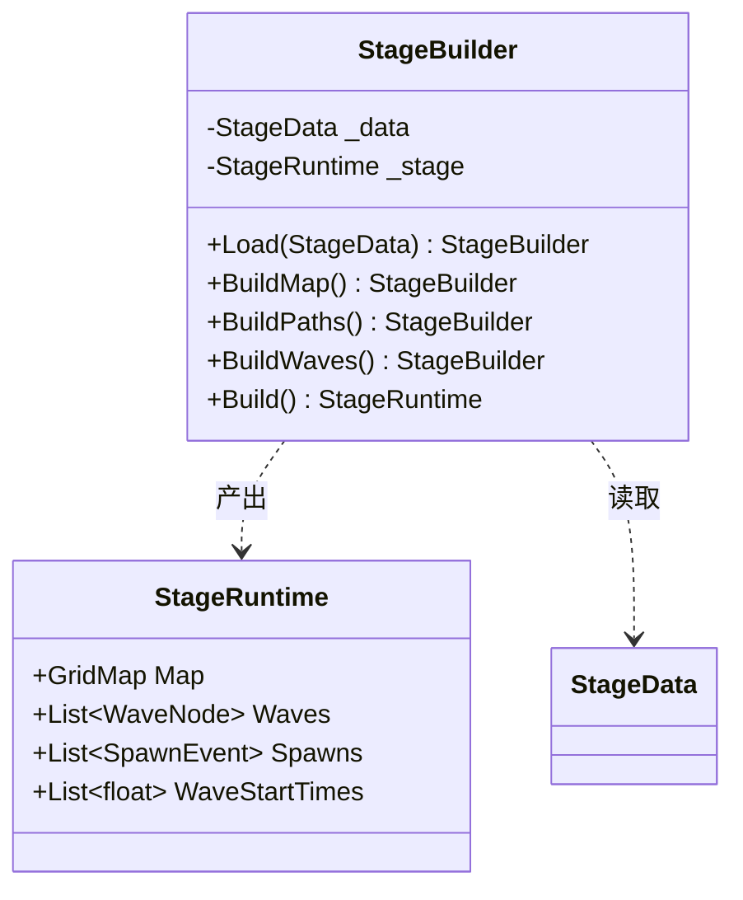
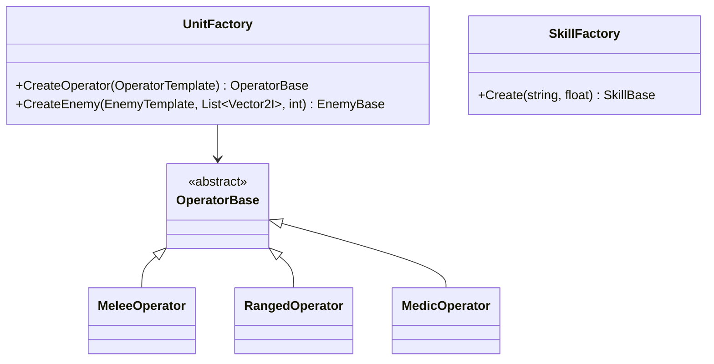
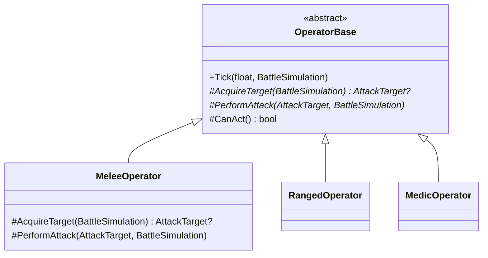
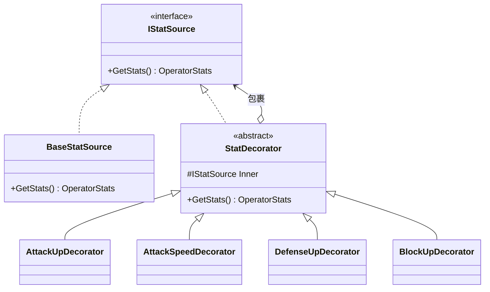
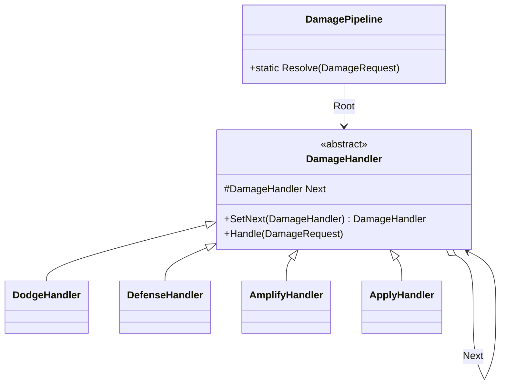
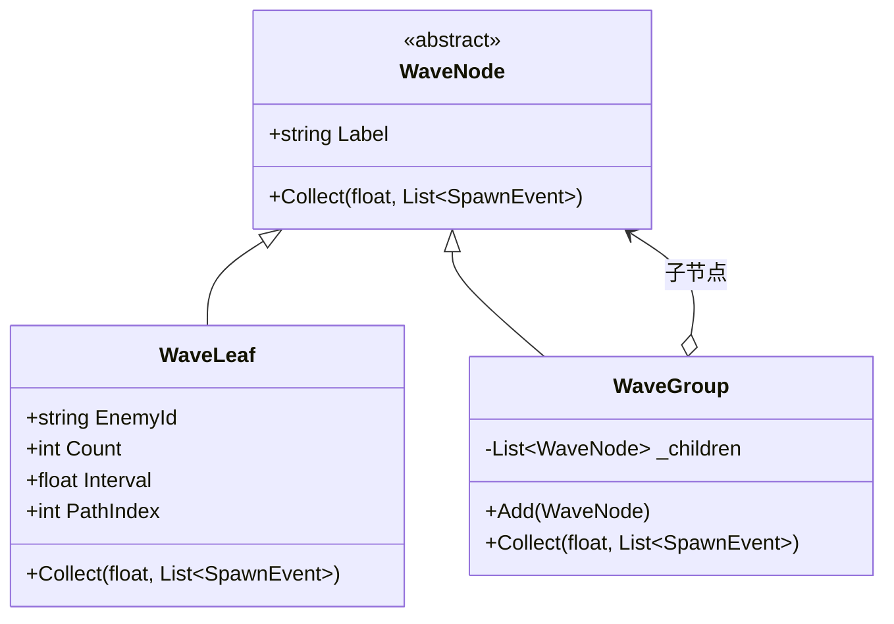

# 设计模式说明

配套代码：`D:\dev\project\godot\arknights_demo`

所有模式都落在**纯 C# 逻辑层**（`src/`），不继承 Godot 的 `Node`。引擎只负责渲染和输入，`BattleView` 每帧读 `BattleSimulation` 的状态再绘制。这样模式结构不会被引擎的组件模型污染，也能用 `--auto` 做无渲染回归。

## 总览

| # | 模式 | 一句话 | 主要文件 |
|---|---|---|---|
| 1 | 单例 | 全局唯一配置表与会话状态 | `ConfigManager`、`GameManager` |
| 2 | 原型 | 单位模板克隆，不重复解析 JSON | `OperatorTemplate`、`PrototypeRegistry` |
| 3 | 建造者 | 分步构建关卡 | `StageBuilder` |
| 4 | 工厂方法 | 模板 → 运行时单位 / 技能 | `UnitFactory`、`SkillFactory` |
| 5 | 模板方法 | 干员行为骨架固定，子类填步骤 | `OperatorBase.Tick` |
| 6 | 装饰器 | 属性 buff 可任意叠加 | `IStatSource`、`StatDecorator` |
| 7 | 责任链 | 伤害结算管线 | `DamagePipeline` |
| 8 | 组合 | 波次树 | `WaveNode` / `WaveGroup` / `WaveLeaf` |

## 一次攻击走完所有模式

```
ConfigManager(单例) 读入 JSON
   → PrototypeRegistry 克隆出 OperatorTemplate(原型)
   → StageBuilder 构建关卡(建造者)
   → UnitFactory 生成干员和敌人(工厂)
   → OperatorBase.Tick 执行行为骨架(模板方法)
   → Stats 经 IStatSource 链计算，buff 是装饰器(装饰器)
   → DamagePipeline 结算伤害(责任链)
   → WaveGroup 驱动波次(组合)
```

---

## 1. 单例（Singleton）

**意图**：配置表和当前对局必须全局唯一，避免到处传引用。



- `ConfigManager.Instance.LoadAll()`：`res://assets/data/*.json` 只解析一次。
- `GameManager.Instance`：当前关卡、编队、上一局结果。

**为什么不用 static 类**：static 类无法实现接口、无法懒加载、测试时不能替换成假实现。这里用 `sealed class` + 私有构造 + `static Instance`，兼顾唯一性和可替换性。

**答辩可能被问**：单例是不是全局变量？—— 是，但它只有读写配置和会话状态两种职责，且没有跨模块可变共享（战斗状态在 `BattleSimulation` 里，随对局创建销毁）。

---

## 2. 原型（Prototype）

**意图**：干员和敌人的配置复杂、部署频繁，克隆现成实例比每次解析 JSON 快，也避免共享可变状态。



关键点：`Clone()` 用 `MemberwiseClone()` 做浅拷贝，模板字段都是值类型和 `string`（不可变），所以浅拷贝安全。注册表里永远存一份"母版"，对外只给克隆。

**为什么不用 new**：每次 `new OperatorTemplate` 都要重新读表、填 15 个字段，部署时一帧可能克隆多个单位。更重要的是原型保证"母版不可变"，不会被某个实例改坏。

**答辩可能被问**：`Clone` 和 `new` 有什么区别？—— 这里 `Clone` 复制的是已经配置好的对象，省去配置步骤；对简单对象确实没必要。

---

## 3. 建造者（Builder）

**意图**：关卡的构建有严格顺序（地图 → 路径 → 波次 → 编译 spawn 列表），参数多、中间状态不能暴露。



调用方：

```csharp
var stage = new StageBuilder()
    .Load(stages[index])
    .BuildMap()
    .BuildPaths()
    .BuildWaves()
    .Build();
```

**为什么不用构造函数**：五个步骤有依赖（路径要在地图之后展开、波次要在地图之后收集），全塞进构造函数会变成一个巨型参数列表，且无法在中间报"这一步失败了"。

**答辩可能被问**：这和工厂有什么区别？—— 工厂一步产出对象，建造者是多步、有顺序、可校验的产出过程。

---

## 4. 工厂方法（Factory Method）

**意图**：把"根据 id 创建哪个具体类"的决策集中到一处，调用方只拿到抽象类型。



`UnitFactory.CreateOperator` 按 `Profession` 选具体类，`SkillFactory.Create` 按 skill id 选技能类。**新增一个干员不需要改工厂**（职业已覆盖），**新增一个技能只需在 `SkillFactory` 加一个 case**。

**为什么不用散落的 new**：如果每个调用点自己判断职业，`switch (profession)` 会出现在战斗、UI、测试等好几处，加职业时漏改一处就崩。

---

## 5. 模板方法（Template Method）

**意图**：所有干员的每帧行为顺序完全一样，只有"打谁"和"怎么打"不同。



骨架（`OperatorBase.Tick`）：

```csharp
UpdateTimers(dt);              // buff / 状态 / 技能充能
if (!CanAct) return;           // 眩晕、死亡
AttackTimer -= dt;
if (AttackTimer > 0) return;   // 攻击间隔
var target = AcquireTarget(sim);
if (target == null) return;
PerformAttack(target.Value, sim);
AttackTimer = Mathf.Max(0.15f, Stats.AttackInterval);
```

三个子类只实现 `AcquireTarget` 和 `PerformAttack`。医疗干员的 `AttackTarget` 指向友方，`PerformAttack` 变成治疗——骨架完全复用。

**为什么不用继承 + 重写 Tick**：那会导致三份几乎相同的冷却/计时逻辑，一处 bug 要修三遍。

**答辩可能被问**：这和策略模式有什么区别？—— 模板方法固定流程、让子类填步骤；策略是整体替换算法。这里流程不该被替换，所以用模板方法。

---

## 6. 装饰器（Decorator）

**意图**：buff 是运行时动态叠加的，用继承会变成"攻击+攻速+眩晕"的组合爆炸。



`OperatorBase` 持有一条 `IStatSource` 链，每次 buff 变化就重建：

```csharp
IStatSource s = new BaseStatSource(_base);
foreach (var buff in _buffs) s = buff.Wrap(s);
_source = s;
_dirty = true;
```

`StatBuff.Wrap` 是一个 `Func<IStatSource, IStatSource>`，所以装饰器可以重复应用、可以整体移除重建。

**为什么不用继承**：6 种干员 × N 种 buff × M 种组合，类数量会失控。装饰器让"基础属性"和"临时修正"正交。

**答辩可能被问**：装饰器和责任链的区别？—— 装饰器是**包装叠加**（每个都返回同一接口的新对象），责任链是**顺序处理**（每个决定是否继续传递）。

---

## 7. 责任链（Chain of Responsibility）

**意图**：伤害计算有多条规则，顺序敏感，且以后还会加（护盾、易伤、无敌帧）。



链的装配只做一次：

```csharp
dodge.SetNext(defense).SetNext(amplify).SetNext(apply);
```

规则本身：

```csharp
// Physical: max(atk - def, atk * 5%)
// Magical:  max(atk * (1 - res/100), atk * 5%)
// True:     atk
```

**为什么不用 if-else**：现在的伤害入口有三处（干员打敌人、敌人打干员、自爆真伤），把规则写三遍就一定会不一致。链只有一份。

**答辩可能被问**：链太长会不会慢？—— 每帧触发次数是攻击次数，不是帧数；四五个节点可以忽略。真要优化可以合并相邻节点。

---

## 8. 组合（Composite）

**意图**：波次天然是树——一场战斗有若干波，每波有若干敌组，每组有若干刷怪点。



`WaveGroup.Collect` 和 `WaveLeaf.Collect` 签名一致，所以"一波"和"一组"对调用方没有区别。`StageBuilder.Build()` 只调一次根节点的 `Collect`，就得到排好序的完整 spawn 列表。

**为什么不用扁平数组**：扁平数组无法表达嵌套，也无法复用"一组敌人"这个结构。树形结构让关卡配置可以嵌套，且遍历代码只有一份。

**答辩可能被问**：这和树形数据结构有什么区别？—— 组合模式的重点是**统一接口**：叶子节点和容器节点对客户端透明。

---

## 常见提问

**这些模式是不是为了用而用？**

每个模式都能回答"不用会怎样"：

| 拿掉 | 后果 |
|---|---|
| 单例 | 配置表要在 MainScene、BattleView、战斗逻辑之间层层传参 |
| 原型 | 每次部署重新解析 JSON 并填 15 个字段 |
| 建造者 | 关卡构建参数 6+ 个，中间状态暴露 |
| 工厂 | `switch (profession)` 散落在多处 |
| 模板方法 | 三种干员各写一遍冷却/计时逻辑 |
| 装饰器 | buff 组合爆炸 |
| 责任链 | 伤害公式在三个入口各写一遍，必然不一致 |
| 组合 | 波次结构无法嵌套，遍历代码重复 |

**为什么逻辑层不继承 `Node`？**

继承 `Node` 后，`OperatorBase` 就被绑死在场景树上：`_Ready` 生命周期、`QueueFree`、序列化规则都会影响它。现在 `BattleSimulation` 可以在没有 Godot 的情况下跑（`--auto` 就是这么做的），模式结构也保持干净。

**开发中真遇到过的 bug（可以讲）**

1. 近战干员打不到自己阻挡的敌人：被阻挡的敌人和干员同格，而 `front1` 范围不含 `(0,0)`，结果敌人一直磨干员。修复：`MeleeOperator` 优先判定 `Blocker`。
2. 高台干员"阻挡"地面敌人：自爆虫攻击力 0，和狙击互相打不死，永久僵持。修复：`FindBlockerAt` 排除高台职业。
3. 路径只存拐点：敌人沿直线走，但自动布阵和距离计算只看 5 个点，导致布阵错位。修复：`ExpandPath` 展开成逐格坐标。

这三个都不是"模式用错了"，而是**模式落地时的边界条件**——答辩时比背定义有用得多。
